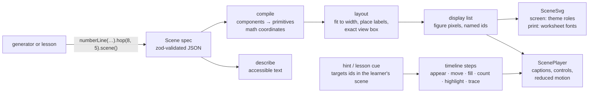

# RFC: one figure and animation framework

Status: accepted; framework (#1177) and timelines landed, print pass and guide next. Code: `src/math/scene/` (spec, layout, components, author API) and `src/web/scene/` (renderer, player).

## Problem

AMP has about 40 figure kinds in a closed union in `src/math/contracts.ts`, drawn by about 26 one-off components (about 6,500 lines). A separate lesson-animation system (about 1,700 lines) redraws some of the same models. Each new problem family adds a kind, a component, a print fix and, sometimes, an animation. The duplicates drift in scale, type, color and label placement. The coordinate plane can draw only points and straight lines, which blocks about 120 high-school skills. Hints never show the learner's own numbers.

## Decision

A figure is **plain data**: a *scene*. One layout engine turns a scene into a display list in figure pixels. One React renderer draws that list for the screen, for print, and inside the animation player. Each component describes itself for screen readers. Animation is a timeline of steps over the same named elements.



## Spec model (`src/math/scene/spec.ts`)

- `Scene = { v: 1, title?, note?, width?, maxHeight?, elements[] }`. Validated by `sceneSchema`, bounded (64 elements, 200 ticks, 60 gridlines, finite coordinates), and carried in a problem as `figure: { kind: "scene", scene }`. Templates that need it gate on the `scenes-v1` capability.
- **Components** (math-aware): `numberLine` (ticks, fraction ticks, marks, hops, intervals), `graph` (coordinate plane and function graph: exact curves for polynomial, rational, exponential, logarithmic, trigonometric, absolute value and square root; piecewise domains with open, closed or arrow ends; half-plane regions and feasible regions; curve regions; circles; segments; slope triangles; secants; scatter points with a fitted line and residuals), `areaModel`, `array`, `tenFrame`, `baseTen`, `fractionBar`, `clock`. The other components in the plan (angles and protractors, rulers, coins, balance, the remaining charts, tables, isometric solids, nets, transformations) follow as families need them, each a single file.
- **Primitives** (what components compile to, also usable directly): `point`, `segment`, `polyline`, `polygon`, `path`, `arc`, `circle`, `rect`, `text` (math or sans), `tick`, `brace`, `arrow` (straight or bowed: a hop).
- **Geometry in math units, decoration in pixels.** Positions are math coordinates with y up. Tick lengths, mark radii, stroke widths, label sizes and label offsets are figure pixels, so they read the same at any data scale.
- **Names.** Every element has an id. Compiled parts get stable dotted names (`nl.hop.0`, `g.curve.0.vertex`, `area.region.1.0`). Timelines, hints and tests address those names.
- **Derived values.** A label the learner is asked to find (a hop's landing, a region's product, a vertex) is `derived`. It is drawn as `?` unless the scene is rendered revealed. Lessons render their example revealed; problems and hints never do. The public payload never contains an answer string.

## Layout (`src/math/scene/layout.ts`)

1. Compile components to primitives. Components receive the current scale, so density choices (tick-label stride) use real pixel spacing.
2. Fit: the math extent and the measured pixel overhang (labels, arrowheads) fit the target width and height ceiling. Components cap their scale (a ten-frame cell never exceeds 50 px). The fit repeats until stable.
3. Place labels. Fixed labels go first. Optional labels (ticks) are dropped rather than drawn over another label or mark. Labels with candidate positions take the first clear one that avoids placed labels, marks, axes, lines and curves.
4. The view box is the union of all ink plus a 4 px pad. Nothing can clip.

Type metrics are exact and need no DOM: KaTeX widths come from KaTeX's own tables, and the sans widths are the widest of Arial, Helvetica and system-ui, measured at the sizes used (`scripts/scene-font-metrics.ts` regenerates them). The gallery fails if any rendered label is wider than its estimate.

Numbers and variables are set in KaTeX fonts, like lesson text: italic variables, TeX spacing around operators, stacked `a/b`, raised exponents. Words (axis names, column labels) use the UI sans on screen and Arial in print.

## Renderer (`src/web/scene/SceneSvg.tsx`)

- One SVG with a fixed `viewBox` and `aspect-ratio`. It scales to its container up to its natural width, so the box is reserved before paint and never shifts.
- Paints are role tokens only (`--color-figure-*`), so light, dark and print follow `tokens.css`, and the color lint covers the renderer.
- Print pages embed the KaTeX fonts already. They set `--scene-sans` to Arial, which the metrics cover. Labels sit inside the view box by construction, so the print layout oracle's label check holds.
- `data-*` hooks (`data-tick`, `data-mark`, `data-point`, `data-hand`, `data-slot`) keep geometric tests independent of the renderer.

## Timeline (`src/math/scene/timeline.ts`, `src/web/scene/ScenePlayer.tsx`)

- `scene.steps[]`: each step has a caption (MathText; `{id}` inserts that element's label, `?` while masked) and actions that run together: `appear` (optionally staggered), `disappear`, `trace`, `highlight` (for its own step only), `fill`, `move` (in math units) and `count`. Each action targets an element id or a part of one (`nl.hop.0`). `audience: "lesson"` marks steps that reveal the result.
- State is a pure function, `frameAt(layout, steps, step, progress)`. An element that a step brings in (`appear`, `trace`) is hidden before that step, so the **start frame is the problem figure** (the givens) and the final frame is the full model. Layout reserves room for every frame, moved parts included.
- Durations and easing are tokens in `tokens.css`: `--motion-step`, `--motion-trace`, `--motion-hold` and `--ease-standard`. Reduced motion sets them to 0. The player then shows the final frame and lists every caption.
- The player has Back, Play (Pause, Replay) and Next controls, all at least 44 px. The stage keeps its aspect box and the captions share one grid cell sized to the tallest, so stepping never moves the page. Captions are announced in a polite live region. On phones (≤ 419 px) scenes lay out at 300 px, so labels keep their size. The choice is made before the first paint and so never shifts the page.
- **Hints on the learner's own scene.** In a hint, the player plays the problem's own scene, masked, and stops before lesson-only steps. A generator can also attach a private `hintCue: Step[]` to the problem. `/hints` returns it as `cue`, next to the hint text, and the player plays it on the same scene: "highlight `area.across.0`", "show `area.product.0.0` (still ?)". A cue that names an element the scene lacks is logged and ignored. Lessons play the example's scene revealed.

## Author API (`src/math/scene/author.ts`)

```ts
numberLine({ min: 0, max: 20 }).mark(8).hop(8, 2, { landing: "shown" }).then(3).scene();
areaModel(34, 6).scene();                      // 30 + 4 by 6, products masked
graph({ x: [-5, 5], y: [-5, 5] })
  .curve(f.vertex(1, 1, -4), { features: ["vertex", "zeros"], featureLabels: "derived" })
  .shade("y < 2x + 1")
  .scene();
```

## Accessibility

`describeScene` composes each component's own sentence from the spec: values, relationships and masked unknowns ("lands on the number to find"). It never depends on color. The SVG is `role="img"` with that label. The timeline announces each step caption in a polite live region.

## Libraries considered

D3 (scales and shapes), JSXGraph and Mafs (interactive plots), and Motion (animation) are mature, but none of them gives exact, DOM-free label metrics for print and server rendering together with role-token theming. Each would also become a second figure system next to AMP's own. The one sizeable dependency this framework uses, KaTeX, is reused for its fonts and metrics. Curve sampling, clipping and the feature computation together come to under 500 lines here and are unit-tested.

## Migration

- Coexistence: `Figure.tsx` routes ported kinds through `legacyScene()` (`src/math/scene/legacy.ts`). Every other kind keeps its component until it is ported.
- Ported in PR 1, with side-by-side gallery parity: `number-line`, `clock`, `coordinate-plane`, `ten-frame`.
- Next, in small PRs, one family at a time, each with a gallery parity card and its existing tests: `base-ten`, `unit-array`, `fraction-strips`/`fraction`, `rational-line`, `bar-chart`, `rectangle`, `right-triangle`, the data displays (`picture-graph`, `scaled-bar-graph`, `line-plot`, `histogram`, `box-plot`), the part-whole and measurement models, the geometry prisms and `quadrant-grid`, and then the lesson illustrations.
- When a kind's last consumer is ported, its legacy component, its case in `Figure.tsx` and its bespoke animation model are deleted.
- New families do not add kinds: they emit `{ kind: "scene" }`.

## What it replaces

The figure-per-kind components, the bespoke lesson-animation stages, per-figure print CSS, and hand-placed label coordinates.

## Verification

- `tests/scene.test.ts`: schema bounds, geometry (equal tick spacing, hop endpoints, proportional regions), exact features, sampling error, half-plane clipping, masking, descriptions, legacy hooks.
- `npx tsx scripts/scene-gallery.ts`: every reference scene, and every ported kind beside its legacy renderer, at 320, 390, 768 and 1280 px in light and dark (`artifacts/scene-gallery/`). It fails on horizontal overflow, a label outside the view box, overlapping labels, or a label wider than its metric estimate.

## Reference screenshots (390 px)

[Number line hops](figures/number-line-hops.png) · [parabola features](figures/parabola-features.png) · [feasible region](figures/feasible-region.png) · [circle, slope triangle and secant, dark](figures/circle-slope-secant-dark.png) · [area model, revealed](figures/area-model-lesson.png) · [coordinate plane: legacy above, scene below](figures/coordinate-plane-parity.png)
