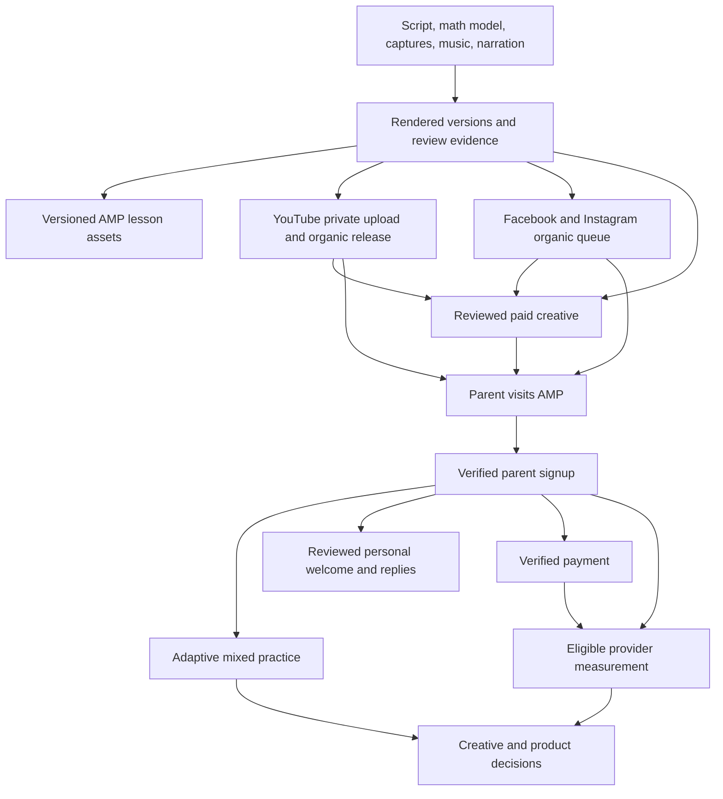

# AMP media production and distribution

AMP uses lessons, product demonstrations, tutoring recordings, and ads to help
parents and educators discover adaptive mixed math practice. This guide connects
production, publication, advertising, and outcome measurement.

## Start here

1. Read the [YouTube operating policy](youtube-publishing.md) before producing or
   publishing video, and the [lesson workflow](../amp/docs/lesson-videos.md) for
   material embedded in AMP.
2. Open the [private media and connections runbook](https://github.com/corpora-inc/infra-private/blob/main/operations/amp-media/README.md)
   for the music inventory, machine paths, platform identities, connection
   configuration, active workers, and recovery steps. Authorized local operators
   can also read `$AMP_MEDIA_ROOT/PIPELINE.md`.
3. Load the local path configuration when using the production machine:
   `source "$HOME/.config/corpora/amp/video.env"`. It defines asset locations;
   it contains no credential values and does not publish anything. On another
   machine, use the private runbook to configure paths that actually exist.
4. Identify the production brief, source manifest, approved output hash, and
   existing platform receipts before rendering or uploading. A dated folder or
   old upload script does not establish approval or current platform state.

The public repository holds reusable tools and product policies. Media sources,
review decisions, account configuration, upload journals, and correspondence
belong in private operational storage. Credentials remain in protected local or
platform secret storage, including when the runbook itself is in private Git.

## How the parts connect

A public video can be used by an ad, but organic publication does not activate a
campaign. A provider's accepted conversion event does not prove attribution or
payment. Compare creative performance with verified AMP signups and payments.

| Component | Maintained entry point | Completion evidence |
| --- | --- | --- |
| Mathematical lessons | [Lesson videos](../amp/docs/lesson-videos.md); `amp/scripts/publish-lesson-video.py` | Reviewed mathematics, narration provenance, final hashes, versioned CDN asset readback, AMP binding |
| Product and cinematic ads | [Advertising workbench](../web/scripts/amp-ads/README.md), [cinema workflow](../web/scripts/amp-ads/cinema/README.md) | Source spec, real product captures, selected takes, music provenance, output QC and review |
| YouTube | [Operating policy](youtube-publishing.md); `amp/scripts/publish-lesson-youtube.py` for lessons | Video ID and visibility, corrected captions, public playlist, settings, viewer-verified pinned CTA |
| Facebook / Instagram | Private runbook's approved queue and Graph API worker | Separate platform IDs, permalinks, final copy and publication readback |
| Paid advertising | [Advertising workbench](../web/scripts/amp-ads/README.md) and private operator configurations | Intended advertiser, campaign/creative IDs, approved spend scope, actual delivery and conversion goals |
| Founder correspondence | [Acquisition pipeline](../amp/docs/acquisition-pipeline.md) | Gmail reconciliation, exact approved message, one send, mailbox receipt and ledger confirmation |
| Results | [Signup conversions](../amp/docs/signup-conversions.md), [funded purchases](../amp/docs/funded-purchases.md) | Verified first-party events, eligible export receipts, provider reports and reconciled revenue |

## Production contract

Use `AMP_MEDIA_ROOT` for dated productions and `AMP_MUSIC_POOL` for the existing
instrumental library. The pool is separate from the repository and credential
folders. An unset variable does not mean the music is missing: load the local
configuration and consult the private inventory before generating a replacement.
Check that cloud-backed files are fully readable.

Media and the background workers that read it live in a plain, non-synced folder
on a directly attached drive, reached through one stable, space-free path
(`~/corpora-media`) that `video.env` builds on. Never put production media,
receipts, or launchd workers under `~/Documents`, `~/Desktop`, or
`~/Library/Application Support`: those are synced or special macOS locations,
and iCloud's Optimize Storage evicts files in place, so a worker that reads an
evicted file fails with `OSError: [Errno 11] Resource deadlock avoided`. Workers
fail cleanly while the drive is unplugged; reconnect it rather than relocating
files. Record the selected track's
source path, SHA-256, rights/provenance, edit offset, fades, and mix settings.
A rendered music segment is an edit artifact, not the canonical source track.

Generated narration uses exactly one approved ElevenLabs voice:

- Madeline Brousseaux, Southern alto: `XescS24CsOySAkKrLAO3`.
- Paul, Southern, Reassuring, Calm: `J3Ei0Lj6fAobhIqY5ySH`.

Resolve by ID, preserve the script, model, voice ID, and audio hash, and validate
before rendering. Old examples suggesting other voices are not approved AMP
presets. Keep original speaking audio for genuine tutoring recordings.

Build mathematical objects from the actual quantities and relationships. Keep
scene construction separate from typography, narration timing, and final
composition. Reuse reviewed geometry and layout helpers, but independently
check each lesson's mathematics. See the lesson workflow for source-package
requirements, Blender dependencies, captions, and product integration.

Review the exact final export at phone size and watch/listen through the full
cut. Verify continuity, mathematical labels, centering, safe areas, captions,
voice clarity, music level, ending, and actual product behavior. Bind QC and
approval to that export's hash; a later render needs its own verification.
Keep superseded versions explicitly labeled. Approval for one format does not
prove another crop is readable.

Every paid concept must satisfy the [complete format and campaign requirements](youtube-publishing.md#paid-video-format-and-campaign-requirements). Run the shared delivery check on final exports; require live Excellent asset-group ratings and resolve campaign recommendations after changes and during daily review.

## Distribution and daily operation

Use the shared YouTube calendar and the existing platform receipts to avoid
competing schedules and duplicate uploads. Preserve live video URLs when
correcting editable settings. Upload lessons privately using the maintained
uploader and the supplied release plan; use Studio for controls the uploader
cannot set. A release receipt that lists a future pinned comment is a pending
task until the viewer page shows the comment pinned.

The normal YouTube target is one release every four hours, with a 12–36 hour
review window after private upload. Skylar may explicitly authorize a queue
drain or other timing exception. The lesson scheduler enforces its configured
limits; prose or owner approval does not change that implementation. Record
exceptions in private release receipts and verify the same publishing controls.

The initial daily routine uses America/New_York time:

| Time | Work |
| --- | --- |
| 08:30 / 09:00 | Reconcile Gmail and the acquisition ledger; review and send eligible, approved personal welcomes, including overdue prospects |
| 10:00 | Review ready media; upload privately and prepare captions, metadata, playlists, and CTA |
| 12:00 / 18:00 | Facebook and Instagram releases from the approved queue |
| 13:00 / 21:00 | YouTube Community question or poll tied to useful content |
| 16:30 | Review prospect replies and substantive social comments |
| 17:00 | Check the next day's queue and record verified releases, sends, and blockers |

The social worker publishes queued assets while its host is available. Native
YouTube schedules execute on YouTube. Community preparation, final pinning,
email review, and the overall daily checklist require operator work; a routine
JSON file is not a scheduler. The private runbook identifies installed jobs and
their limits. Reconcile Gmail immediately before sending, use the acquisition
pipeline's audited timing override for the morning batch, and retain its
message-approval process. Silence never triggers an automatic personal follow-up.

## Measurement and handoff

Preserve the relationship between a concept, source manifest, output hash,
platform post/video, paid creative, and campaign attribution. Keep opaque
operational IDs in private receipts; customer-facing copy describes the product.
Google Ads, Meta Ads, and OpenAI Ads have separate connections and settings.
YouTube authorization does not grant Google Ads access, and organic Meta
publishing authorization does not establish an advertising budget.

Use [ad-click attribution](../amp/docs/ad-click-attribution.md),
[signup conversions](../amp/docs/signup-conversions.md), and the
[Google](../amp/docs/google-purchase-measurement.md),
[Meta](../amp/docs/meta-purchase-measurement.md), and
[OpenAI](../amp/docs/openai-purchase-measurement.md) purchase contracts.
Keep signups, payments, provider acceptance, and platform-attributed conversions
separate. Check current campaign goals before interpreting results; exporting
an event does not change bidding. Learner activity is not an ad-platform export.

When handing off a production, leave its brief, source paths, exact voice and
music provenance, final hashes, QC/review evidence, platform receipts, and
remaining actions together. Update the private connection map when a worker,
credential reference, or storage location changes. Reconcile an uncertain write
against the platform before retrying; never delete the journal to start over.
